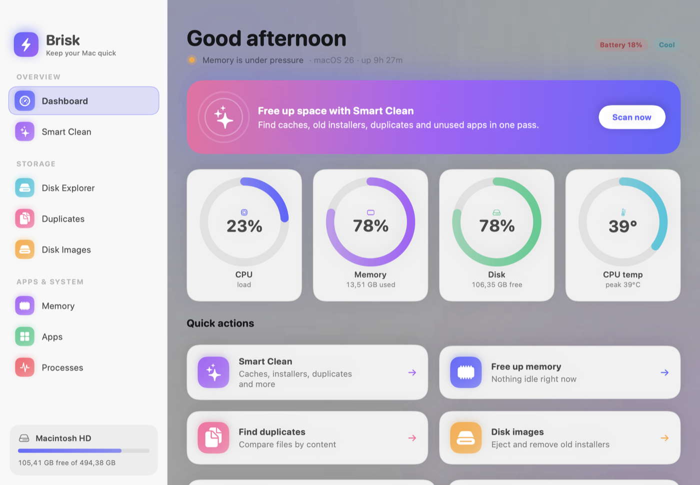
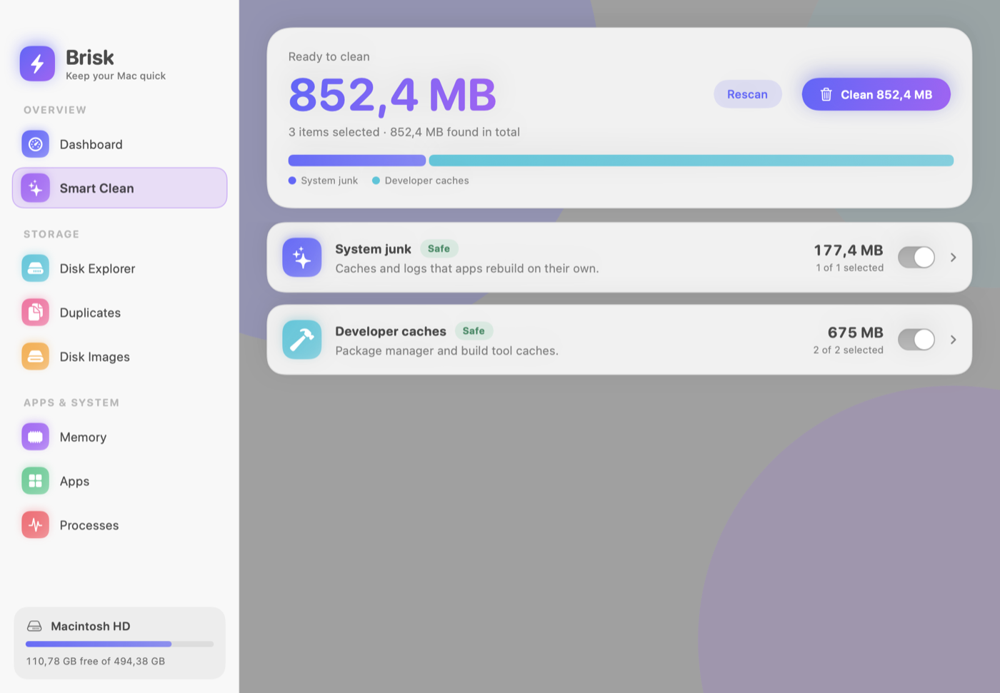
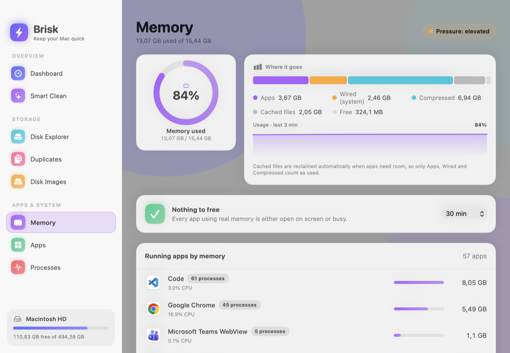

# Brisk

**A fast, friendly Mac cleaner and system monitor.** See what is using your CPU, memory and disk, and reclaim space safely, all in one native app.

[**Download Brisk for Mac**](https://github.com/KaroHovhannisyan/brisk/releases/latest/download/Brisk.dmg) · [All releases](https://github.com/KaroHovhannisyan/brisk/releases)

Signed with a Developer ID and notarized by Apple. Native SwiftUI, no accounts, no tracking. Updates itself.

## What it does

| | |
|---|---|
| **Dashboard** | Live CPU load, memory, disk and CPU temperature, with a health summary and quick actions. |
| **Smart Clean** | One scan finds caches, logs, developer caches, old installers, forgotten `node_modules`, duplicates, large old files and unused apps. You review everything first, then watch live progress while it cleans. |
| **Disk Explorer** | Drill into any folder to see what takes space, as a list or a treemap. Select items and move them to the Trash. |
| **Duplicates** | Finds identical files by content (not by name). At least one copy of every file always stays. |
| **Disk Images** | Lists mounted `.dmg` volumes with one-click eject, and finds leftover installers. |
| **Memory** | Per-app memory including helper processes, a usage graph, apps that are running but not in use, and background agents that start at login. |
| **Apps** | Sizes and last-used dates, with an uninstaller that also finds leftover files. |
| **Processes** | A sortable process list with quit buttons. |

## Install

1. Download **Brisk.dmg** from the [latest release](https://github.com/KaroHovhannisyan/brisk/releases/latest).
2. Open it and drag **Brisk** onto **Applications**.
3. Launch Brisk from Applications.

**Requirements:** macOS 14 (Sonoma) or later, Apple Silicon Mac.

### Updates

From version 1.1, Brisk checks for new versions once a day and offers to install them. Updates are verified with a cryptographic signature before they are applied. You can also check by hand with **Brisk → Check for Updates…** or the link at the bottom of the sidebar. If you are on 1.0, download the latest `Brisk.dmg` once; after that updates are automatic.

### Optional: Full Disk Access

Brisk works without it. To let it see and size everything in your Library folders, add it under **System Settings → Privacy & Security → Full Disk Access**.

## Safety

- **Nothing is deleted without your review.** Smart Clean pre-selects only safe items such as caches and old installers. Anything riskier (duplicates, large files, unused apps, `node_modules`) is off until you turn it on.
- **Recoverable by default.** Files go to the Trash so you can restore them. Only rebuildable caches and the Trash itself are deleted permanently, and the result screen tells you which is which.
- **Contained.** Brisk only touches files inside your home folder and `/Applications`.
- **Quitting apps is polite.** It asks apps to quit normally, so they can offer to save your work. System apps and terminals are never suggested.

## Privacy

Brisk runs entirely on your Mac and collects no data. The only network request it makes is the daily check for a new version, which downloads a small public file from this repository (`appcast.xml`). It sends no information about you or your Mac.

## Notes

- The memory page flags an app as "not in use" from its CPU activity, whether you hid it, and how long it has sat in the background. It cannot see other apps' windows, so it never assumes a visible app is idle until the idle timer you set has passed.
- "Last used" dates for apps come from Spotlight. If Spotlight indexing is off on your Mac, those dates show as unknown.

## Uninstall

Drag **Brisk** from Applications to the Trash. Brisk keeps no data of its own beyond standard macOS window preferences.
